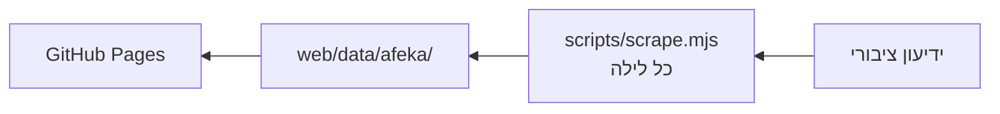

<div dir="rtl" lang="he">
<div align="center">

# המערכת שלי

**בונים מערכת שעות לאפקה: בוחרים קורסים ומקבלים עד 10 מערכות מוכנות, בלי חפיפות.**

**[לפתיחת האתר ←](https://dolev-benezri.github.io/lets_learn/)**

[](https://github.com/dolev-benezri/lets_learn/actions/workflows/deploy.yml)
[](https://dolev-benezri.github.io/lets_learn/)


<picture>
  <source media="(prefers-color-scheme: dark)" srcset="docs/media/01-week-desktop-dark.webp?v=20261017-2">
  
</picture>

</div>

> **כלי לא רשמי של סטודנטים, ללא קשר למכללת אפקה.** הנתונים מהידיעון הציבורי ויכולים להיות שגויים או לא מעודכנים, ולכן ההרשמה באפקה-נט היא הקובעת. [תנאי שימוש ופרטיות](https://dolev-benezri.github.io/lets_learn/legal.html)

## מה זה עושה

### מערכות מוכנות, בלי לשבץ ביד

ארבעה שלבים בסרגל בראש הדף: המצב שלי, קורסים, מה חשוב לי, מערכות. אתם קובעים מה חשוב לכם (ימים פנויים, בלי חלונות, שעות נוחות, להיות עם חברים) ומקבלים עד 10 מערכות מדורגות, מהטובה לפחות טובה. אפשר לבחור לפי מה לסדר אותן: הכי הרבה נ״ז, הכי הרבה עם חברים או הכי הרבה קורסי המשך. אפשר לתכנן שנה שלמה (עם קיץ, למי שמסמן שהוא מתכנן קיץ) או סמסטר אחד, ולנעוץ קבוצה שאתם רוצים בכל מקרה. בטלפון רואים יום אחד בכל פעם, ובמצב כהה או בהיר.

<p align="center">
<picture>
  <source media="(prefers-color-scheme: dark)" srcset="docs/media/02-week-phone-dark.webp?v=20261017-2">
  
</picture>
</p>

### לפי התקנון והמצב שלכם

**נכשלתם בקורס? גם קורסי ההמשך שלו נחסמים.** מסמנים מה עברתם ומה לא (או מייבאים את גיליון הציונים, שמסמן גם פטורים), והכלי מחשב את דרישות הקדם, הקורסים המקבילים והחזרה על קורסים. מפת ההתקדמות (הכפתור "מפה" בשלב 4) מראה את כל התואר בתמונה אחת, ומה כל חלופה עושה לו.

<picture>
  <source media="(prefers-color-scheme: dark)" srcset="docs/media/03-map-desktop-dark.webp?v=20261017-2">
  
</picture>

### עם חברים

בשלב 3 ("מה חשוב לי") מוסיפים חבר בקישור שהוא שלח, בהדבקת טקסט, מקובץ PDF או מתמונה של המערכת שלו (הזיהוי נעשה בדפדפן שלכם). שיעור משותף מסומן בלוח, והחיפוש מעדיף מערכות עם יותר שיעורים משותפים. ב"הצג לפי" אפשר לדרג קודם את המערכות עם הכי הרבה שיעורים עם חברים.

<p align="center">
<picture>
  <source media="(prefers-color-scheme: dark)" srcset="docs/media/04-friends-phone-dark.webp?v=20261017-2">
  
</picture>
</p>

## התחלה מהירה

נכנסים [לאתר](https://dolev-benezri.github.io/lets_learn/). מאשרים את תנאי השימוש, עונים על שתי שאלות קצרות, ואחריהן ארבעה שלבים בסרגל בראש הדף. אפשר לקפוץ ביניהם בכל רגע. בכניסה הראשונה סיור קצר מראה את השלבים, ואפשר לראות אותו שוב מהכפתור "סיור באתר" בסרגל.

### 1. מסלול ושנה

כל שאלה במסך משלה: באיזה מסלול (תוכנית, יום או ערב; שום מסלול לא נבחר מראש), ובאיזו שנת לימודים. "שינוי" מחזיר לבחירת המסלול.

<p align="center">
<picture>
  <source media="(prefers-color-scheme: dark)" srcset="docs/media/05-start-track-phone-dark.webp?v=20261017-2">
  
</picture>
<picture>
  <source media="(prefers-color-scheme: dark)" srcset="docs/media/06-start-year-phone-dark.webp?v=20261017-2">
  
</picture>
</p>

### 2. המצב שלי

הפרופיל וההתקדמות בתואר, והצעה לייבא את גיליון הציונים הרשמי מהפורטל (PDF). הגיליון מסמן מה עברתם, במה נכשלתם ומאילו קורסים קיבלתם פטור. מי שמעדיף לוחץ "הזנה ידנית" ומסמן בעצמו את הקורסים, לפי שנה.

<picture>
  <source media="(prefers-color-scheme: dark)" srcset="docs/media/07-start-entry-desktop-dark.webp?v=20261017-2">
  
</picture>

### 3. קורסים

לכל קורס בוחרים חובה, אולי או לא. ליד כל קורס כתוב כמה קורסים הוא פותח ובאיזה סמסטר הוא נכנס למערכת. קורסים חסומים או כאלה שלא נלמדים בסמסטר מופיעים בנפרד, עם הסיבה.

<p align="center">
<picture>
  <source media="(prefers-color-scheme: dark)" srcset="docs/media/08-courses-phone-dark.webp?v=20261017-2">
  
</picture>
</p>

### 4. מה חשוב לי

מסמנים העדפות (ימים פנויים, בלי חלונות, שעות) ומוסיפים חברים (ראו [עם חברים](#עם-חברים)).

### 5. מערכות

המערכות נבנות מיד. מדפדפים בין החלופות עם החצים בראש הלוח, ולחיצה על שיעור פותחת פרטים ונעיצה. הכפתור "מפה" פותח את מפת ההתקדמות. בסוף פותחים את "רשימה להרשמה" ומעתיקים אותה לאפקה-נט, מדפיסים "סיכום ליועץ" לפגישה עם היועץ, או לוחצים "שתף" כדי לשלוח קישור לחבר. הכלי עוזר לתכנן, וההחלטה וההרשמה נשארות אצלכם ואצל ההכוון האקדמי.

**הצג לפי** נותן ארבע אפשרויות: מאוזן (לפי ההעדפות שלכם), הכי הרבה נ״ז, הכי הרבה עם חברים, ופותחת הכי הרבה קורסי המשך. הבחירה מסדרת את המערכות, אבל בתכנון שנה מלאה (שני סמסטרים) מערכת עם פחות קורסי חובה חסרים תמיד באה קודם. "הכי הרבה עם חברים" עובד רק כשיש חבר אחד לפחות שמוצג במערכת, ואחרת הסדר הוא "מאוזן".

## עוד יכולות

<details>
<summary>כל היכולות</summary>

- **מה חשוב לכם:** חברים, התקדמות בתואר, ימים פנויים, בלי חלונות, שעות נוחות ופיזור בחינות, כל אחד בארבע דרגות.
- **מה חייב להיות:** יום חופש, טווח שעות, מספר מרבי של ימים בקמפוס, או מרצה מסוים (או בלעדיו).
- **השוואה:** מחלופה 2 והלאה מופיעה שורה "לעומת חלופה 1" עם ההבדלים.
- **שנה מלאה:** זוג מערכות לסמסטר א׳ וב׳, כשקורס מא׳ פותח את ההמשך שלו בב׳. מי שמסמן "אני מתכנן/ת סמסטר קיץ" מקבל לשונית שלישית, קיץ, ליד א׳ וב׳. הקיץ מתוכנן מעל מערכת השנה ונספר בהתקדמות.
- **אזהרות לפי התקנון:** כשהממוצע או מספר הכישלונות מסכנים אתכם (לימודים על תנאי, הרחקה).
- **גיליון ציונים:** קובץ ה-PDF מהפורטל נקרא רק בדפדפן שלכם ולא נשמר. הציונים, הכישלונות והפטורים (פטור פנימי) מסומנים לבד, וקורס עם פטור מסומן "פטור" ברשימה.
- **אנגלית:** אם ציון האמירנט שלכם מספיק, קורסי האנגלית מסומנים כפטור.
- **התמחויות:** בחירת התמחות בשנה ג׳ לפי הכלל של המחלקה.
- **רשימת תיוג לסיום התואר:** ב"המצב שלי", כמה נ״ז נשארו בכל דרישה.
- **מפת ההתקדמות:** נפתחת מ"מפה" בשלב 4, עם זום וגרירה, מעבר בין חלופות בלי לאבד את הזום, וראשי תיבות לכל קורס.
- **ייצוא ליומן:** קובץ `.ics` בלי שיעורים בחגים, מתוך "רשימה להרשמה".
- **קישור גיבוי:** מעבירים את הנתונים לטלפון או למחשב אחר בלי להירשם.
- **נגישות:** מותאם לטלפון עד רוחב 320, ניווט מלא במקלדת, ובלי אנימציה למי שביקש להפחית תנועה. כל מסך נבדק אוטומטית מול WCAG 2.1 ברמה AA בדפדפן של Safari, בטלפון ובמחשב, בבהיר ובכהה. [מה נבדק ומה עוד פתוח](docs/ACCESSIBILITY-WCAG21.md) · [הצהרת נגישות (טיוטה, לפני בדיקה של מורשה נגישות)](https://dolev-benezri.github.io/lets_learn/legal.html#accessibility)

</details>

## פרטיות ונתונים

- **בלי הרשמה, ובלי שליחת הנתונים לשום מקום:** מה שסימנתם נשמר רק בדפדפן שלכם.
- **קישור גיבוי או קישור לחבר כולל את הנתונים שלכם בכתובת עצמה.** שולחים אותו רק למי שאתם רוצים.
- **הנתונים מתעדכנים כל לילה** מהידיעון הציבורי. בראש האתר כתוב מתי נבדקו לאחרונה, ובכל קבוצה כתוב "נכון ל-" עם השעה שבה נבדקו המקומות הפנויים.
- **כשמקורות רשמיים סותרים זה את זה** (תוכנית הלימודים מול הידיעון), האתר כותב זאת ב"המצב שלי" וממליץ לבדוק מול המחלקה. תוכנית שהמחלקה אישרה את הכללים שלה מסומנת "אושר על ידי המחלקה".
- **מצאתם שיעור שגוי או שעה לא נכונה, או שאתם רוצים שנסיר מידע?** [פותחים פנייה](https://github.com/dolev-benezri/lets_learn/issues/new/choose) (צריך חשבון GitHub).

## מה נתמך

סמסטרים א׳, ב׳ וקיץ של תשפ״ז, לכל תוכנית בארבעה מחזורים (תחילת לימודים 2024 עד 2027).

| תוכנית | יום | ערב |
|---|---|---|
| הנדסה מכנית | ✓ | ✓ |
| הנדסת חשמל | ✓ | ✓ |
| הנדסת תוכנה | ✓ | ✓ |
| מדעי המחשב | ✓ | ✓ |
| מדעי הנתונים | ✓ | |
| הנדסת תעשייה וניהול | ✓ | ✓ |
| הנדסה רפואית | ✓ | |

הקורסים והקבוצות מהידיעון, והדרישות לתואר מתוכניות הלימודים של תשפ״ז. הפירוט והקישורים: [COVERAGE](docs/COVERAGE.md).

## שאלות נפוצות

<details>
<summary>צריך להירשם או להתחבר?</summary>

לא. אין חשבון. הכול נשמר בדפדפן שבו השתמשתם.

</details>

<details>
<summary>איך מעבירים את המערכת לטלפון?</summary>

בשלב 3 ("מה חשוב לי"), בתחתית כרטיס ההעדפות, לוחצים "העתק קישור גיבוי מלא" ופותחים את הקישור בטלפון. הקישור כולל את הנתונים שלכם, אז שומרים אותו לעצמכם.

</details>

<details>
<summary>למה לא רואים תאריכי בחינות?</summary>

לוח הבחינות של תשפ״ז עוד לא פורסם. כשיפורסם בידיעון, הוא יופיע באתר אחרי הסריקה הלילית.

</details>

<details>
<summary>מה ההבדל בין תוכנית, מסלול ומחזור?</summary>

תוכנית היא המחלקה (למשל הנדסה מכנית), מסלול הוא יום או ערב, ומחזור הוא השנה שבה התחלתם ללמוד.

</details>

<details>
<summary>יש תמיכה בתואר שני?</summary>

לא. האתר מחשב לפי התקנון של תואר ראשון.

</details>

<details>
<summary>מה עושים כשמשהו לא נכון?</summary>

ההרשמה באפקה-נט היא הקובעת. אם מצאתם טעות, [ספרו לנו](https://github.com/dolev-benezri/lets_learn/issues/new/choose) ונתקן.

</details>

## למפתחים

JavaScript נקי בלי build, אתר סטטי ב-GitHub Pages, וסריקה לילית של הידיעון ב-GitLab CI.



```bash
npm ci
npm test                      # בדיקות יחידה
npx playwright install webkit
npm run test:browser          # דפדפן אמיתי: נגישות (axe), זרימות מלאות והסיור
npm run report:rules          # דף כללים לכל תוכנית ומחזור, לאישור המחלקה (out/rules/)
npm run report:conflicts      # דף סתירות לכל מחלקה (docs/conflicts/)
npx http-server web -p 8080 -c-1
```

הרצה ובדיקות: [DEVELOPING](docs/DEVELOPING.md) · מבנה הקוד: [ARCHITECTURE](docs/ARCHITECTURE.md) · תפעול: [OPERATIONS](docs/OPERATIONS.md) · אבטחה: [SECURITY](docs/SECURITY.md) · נגישות: [WCAG 2.1](docs/ACCESSIBILITY-WCAG21.md) · ניסוי עם סטודנטים: [BETA](docs/BETA.md) · תרומה: [CONTRIBUTING](CONTRIBUTING.md) · כל התיעוד: [docs](docs/README.md)

---

[רישיון MIT](LICENSE), נבנה על ידי [dolev-benezri](https://github.com/dolev-benezri). הפונט Rubik ברישיון [SIL OFL](web/fonts/OFL.txt).

</div>
