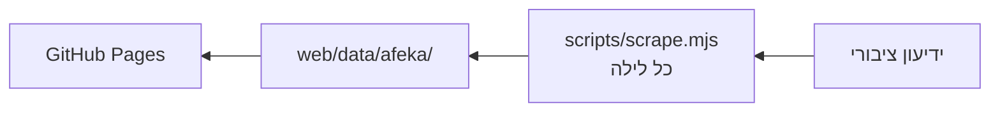

<div dir="rtl" lang="he">
<div align="center">

<picture>
  <source media="(prefers-color-scheme: dark)" srcset="docs/media/banner-dark.webp?v=20261102">
  
</picture>

**בוחרים קורסים ומקבלים מערכות שעות מוכנות בלי חפיפות, לפי התקנון וההתקדמות האישית.**

**[לפתיחת האתר ←](https://dolev-benezri.github.io/lets_learn/)**

[](https://github.com/dolev-benezri/lets_learn/actions/workflows/deploy.yml)
[](https://dolev-benezri.github.io/lets_learn/)

<picture>
  <source media="(prefers-reduced-motion: reduce) and (prefers-color-scheme: dark)" srcset="docs/media/02-week-phone-dark.webp?v=20261102">
  <source media="(prefers-reduced-motion: reduce)" srcset="docs/media/02-week-phone.webp?v=20261102">
  <source media="(prefers-color-scheme: dark)" srcset="docs/media/demo-dark.gif?v=20261102">
  
</picture>

</div>

> **כלי לא רשמי, ללא קשר למכללת אפקה.** הנתונים מהידיעון הציבורי ועלולים להיות שגויים או לא מעודכנים, וההרשמה באפקה-נט היא הקובעת. [תנאי שימוש ופרטיות](https://dolev-benezri.github.io/lets_learn/legal.html)

## מה הכלי עושה

- **מערכות מוכנות, בלי לשבץ ביד.** הסטודנט מסמן מה חשוב לו (ימים פנויים, בלי חלונות, שעות נוחות, להיות עם חברים) ומקבל עד 10 מערכות מדורגות בלי חפיפות (ועוד חלופות, למי שבוחר להפריד הרצאה ותרגול), לסמסטר אחד או לשנה שלמה, כולל קיץ למי שמתכנן אותו.
- **לפי התקנון והמצב האישי.** הכלי מחשב דרישות קדם, קורסים מקבילים, חזרה על קורסים ופטורים, ואפשר לייבא את גיליון הציונים הרשמי, שנקרא בדפדפן בלבד. כשקורס לא נכנס לחלופה, כתוב איזה קורס. "סיכום ליועץ" מודפס לפגישה עם ההכוון האקדמי.
- **עם חברים.** שיעור משותף מסומן בלוח, והחיפוש מעדיף מערכות עם יותר שיעורים משותפים.

<picture>
  <source media="(prefers-color-scheme: dark)" srcset="docs/media/03-map-desktop-dark.webp?v=20261102">
  
</picture>

[המדריך המלא וכל היכולות](docs/GUIDE.md)

## מה הכלי לא עושה

- **לא רושם לקורסים.** ההרשמה נעשית באפקה-נט, והיא הקובעת.
- **לא מחליף הכוון אקדמי.** הכלי עוזר לתכנן, וההחלטה נשארת אצל הסטודנט והיועץ.
- **לא מתחבר למערכות המכללה.** הוא קורא דפים ציבוריים של הידיעון, בלי התחברות ובלי גישה למידע אישי של סטודנטים.

## מצב הפרויקט

האתר פעיל ופתוח לכולם. הוא נבנה ומתוחזק בידי סטודנט אחד, ואינו שירות של המכללה. עדיין לא נערך ניסוי מסודר עם סטודנטים, והכללים לא אושרו על ידי המחלקות. [הצהרת הנגישות](https://dolev-benezri.github.io/lets_learn/legal.html#accessibility) היא טיוטה שלא נבדקה בידי מורשה נגישות.

מחלקה יכולה לבדוק מה הכלי קורא בכללים שלה: `npm run report:rules` מפיק דף להדפסה ולחתימה לכל תוכנית ומחזור, ו-`npm run report:conflicts` דף של הסתירות הפתוחות. [הסבר](docs/OPERATIONS.md#בדיקות-ודוחות)

## מה נתמך

סמסטרים א׳, ב׳ וקיץ של תשפ״ז, לכל תוכנית בארבעה מחזורים (תחילת לימודים 2024 עד 2027). תואר ראשון בלבד.

| תוכנית | יום | ערב |
|---|---|---|
| הנדסה מכנית | ✓ | ✓ |
| הנדסת חשמל | ✓ | ✓ |
| הנדסת תוכנה | ✓ | ✓ |
| מדעי המחשב | ✓ | ✓ |
| מדעי הנתונים | ✓ | |
| הנדסת תעשייה וניהול | ✓ | ✓ |
| הנדסה רפואית | ✓ | |

הפירוט והקישורים לתוכניות הלימודים: [COVERAGE](docs/COVERAGE.md).

## נתונים, פרטיות ואבטחה

**נתונים**

- הקורסים והקבוצות נאספים בסריקה לילית מהדפים הציבוריים של הידיעון, בקצב מוגבל ועם תקציב לרענון דפים שכבר נקראו. הקבוצות של קורס נבדקות כל לילה שני, אז מספר המקומות הפנויים עלול להיות בן יומיים, וליד כל מספר כתוב מתי הוא נקרא.
- הדרישות לתואר מתוכניות הלימודים של תשפ״ז (במדעי הנתונים של תשפ״ו).
- סריקה שנכשלת בבדיקות או פריסה שנכשלת לא מחליפות את מה שכבר באוויר.
- כשמקורות רשמיים סותרים זה את זה, האתר כותב זאת וממליץ לבדוק מול המחלקה.

**פרטיות ואבטחה**

- אתר סטטי ב-GitHub Pages: בלי חשבון, בלי שרת משלנו, בלי עוגיות ובלי כלי אנליטיקה. שום דבר לא נטען מאתר חיצוני.
- מה שהסטודנט מזין נשמר רק בדפדפן שלו. אלינו מגיע רק דיווח שהוא בוחר לשלוח במייל.
- קישור גיבוי או קישור לחבר כולל את הנתונים בכתובת עצמה, ולכן שולחים אותו רק למי שרוצים.
- הפירוט: [אבטחה ופרטיות](docs/SECURITY.md) · [תפעול](docs/OPERATIONS.md) · [תנאי שימוש ופרטיות](https://dolev-benezri.github.io/lets_learn/legal.html)

**בדיקות**

- בדיקות אוטומטיות רצות על כל דחיפה ל-`main` שנוגעת באתר, בבדיקות או בסקריפטים, ופריסה לא יוצאת אם הן נכשלות.
- בדיקה על הנתונים האמיתיים של כל התוכניות רצה אחרי כל דחיפה כזו של אתר או נתונים. כשל שולח התראה ולא עוצר את הפריסה.
- בדיקות נגישות בדפדפן אמיתי מול WCAG 2.1 AA קיימות ומורצות ידנית, לא בכל שינוי. [מה נבדק ומה עוד פתוח](docs/ACCESSIBILITY-WCAG21.md)

## שאלות נפוצות

<details>
<summary>צריך להירשם או להתחבר?</summary>

לא. אין חשבון. הכול נשמר בדפדפן שבו השתמשתם.

</details>

<details>
<summary>איך מעבירים את המערכת לטלפון?</summary>

בשלב 3 ("מה חשוב לי"), בתחתית כרטיס ההעדפות, לוחצים "העתק קישור גיבוי מלא" ופותחים את הקישור בטלפון. הקישור כולל את הנתונים שלכם, אז שומרים אותו לעצמכם.

</details>

<details>
<summary>מאיפה תאריכי הבחינות?</summary>

התאריכים של תשפ״ז נמשכו פעם אחת ביד מדפי הקורסים בידיעון, כי טבלת הבחינות שם עדיין ריקה, והם נכנסים לאתר בסריקה הלילית. הם לא מתעדכנים לבד. כשהטבלה בידיעון תתמלא, היא תגבר עליהם. המועדים הרשמיים הם של המכללה.

</details>

<details>
<summary>מה ההבדל בין תוכנית, מסלול ומחזור?</summary>

תוכנית היא המחלקה (למשל הנדסה מכנית), מסלול הוא יום או ערב, ומחזור הוא השנה שבה התחלתם ללמוד.

</details>

<details>
<summary>מצאתי טעות, או שאני רוצה שיוסר מידע. מה עושים?</summary>

כותבים ל-letslearn.schedule@gmail.com, או [פותחים פנייה ב-GitHub](https://github.com/dolev-benezri/lets_learn/issues/new/choose) (צריך חשבון, והיא גלויה לכולם). בינתיים ההרשמה באפקה-נט היא הקובעת.

</details>

## למפתחים

JavaScript נקי בלי build, אתר סטטי ב-GitHub Pages, וסריקה לילית של הידיעון ב-GitLab CI.



```bash
npm ci
npm test                      # בדיקות יחידה
npm run check:real            # כל התוכניות האמיתיות, כדקה; לפני מיזוג שנוגע בפותר או בכללים
npx http-server web -p 8080 -c-1
```

הרצה ובדיקות: [DEVELOPING](docs/DEVELOPING.md) · מבנה הקוד: [ARCHITECTURE](docs/ARCHITECTURE.md) · תרומה: [CONTRIBUTING](CONTRIBUTING.md) · ניסוי עם סטודנטים: [BETA](docs/BETA.md) · כל התיעוד: [docs](docs/README.md)

---

קשר: letslearn.schedule@gmail.com · [רישיון MIT](LICENSE) · נבנה על ידי [dolev-benezri](https://github.com/dolev-benezri) · הפונט Rubik ברישיון [SIL OFL](web/fonts/OFL.txt)

</div>
